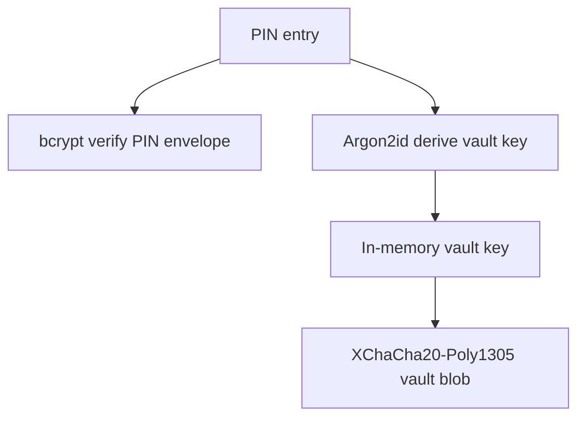

# my-enkript — Features and functionality

This guide describes what the **my-enkript** mobile app does today: screens, workflows, security behavior, and known limitations. It is written for users and contributors who want to understand the product without reading source code.

For engineering notes, see [IMPLEMENTATION.md](./IMPLEMENTATION.md). For market research and roadmap ideas, see [FEATURE_RESEARCH_REPORT.md](./FEATURE_RESEARCH_REPORT.md) (research snapshot; not all items are shipped).

---

## Overview

**my-enkript** is a **local-first password vault** for iOS and Android. Your logins, notes, cards, and passkeys are stored on your device inside an encrypted vault. There is **no cloud account** and no automatic sync between devices.

| Attribute | Detail |
|-----------|--------|
| **Platforms** | iOS and Android (Expo / React Native) |
| **Bundle ID** | `com.maxhuni.eroll.myenkript` |
| **Storage** | Encrypted data in the device secure store (`expo-secure-store`) |
| **Unlock** | PIN (4–6 digits); optional biometrics for **revealing** secrets only |
| **Desktop companion** | Optional Chrome extension + WebSocket relay for fill and passkeys |

### What you can store

- **Logins** — title, username, password, URL, notes, category, optional TOTP secret
- **Secure notes** — free-form text (Wi‑Fi passwords, recovery codes, etc.)
- **Payment cards** — cardholder, number, expiry, CVV
- **Passkeys** — WebAuthn credentials created through the browser bridge
- **Paired browsers** — desktop Chrome sessions linked via QR code

---

## First launch and vault unlock

### PIN setup (first time)

When no PIN exists, the app shows the **lock screen wizard**:

1. Choose PIN length (**4, 5, or 6** digits).
2. Enter your PIN.
3. Confirm the same PIN.

On success, the vault is sealed and you enter the main app. A one-time prompt may suggest enabling system autofill.

### Unlock (returning use)

Enter your PIN on the lock screen. While unlocking:

- The app verifies your PIN (bcrypt).
- It derives a vault encryption key (Argon2id).
- It loads and decrypts your data.

If you upgraded from an older build that used legacy storage, you may see **“Vault upgraded”** — your data was re-encrypted with stronger protection (`vault:v2`).

### Failed PIN attempts

After **5 incorrect PINs** in a row:

- In-memory secrets are cleared.
- The app locks again.
- You must enter the correct PIN to continue.

### Auto-lock

When the app goes to the background, a timer starts. If you stay away longer than the configured timeout, the vault **locks automatically** and secrets are removed from RAM.

Configure timeout under **Settings → Security → Lock timing**:

| Option | Behavior |
|--------|----------|
| 30 seconds | Lock quickly after leaving the app |
| 1 minute | Default-style short timeout |
| 5 minutes | Longer convenience window |
| Never | Stay unlocked until you tap **Lock now** or force-quit |

You can also tap **Lock now** on the Security screen at any time.

---

## Main tabs

The app has four bottom tabs: **Passwords**, **Passkeys**, **Generator**, and **Settings**.

### Passwords

Your primary credential list.

**List view**

- **Search** — filter by title, username, or URL.
- **Categories** — entries are grouped under Social, Work, Finance, Shopping, or Other.
- **Pull to refresh** — reload from encrypted storage (when vault is unlocked).
- **Long-press** on a card — quick actions (e.g. delete).

**Add / edit**

- Fields: title, username, password, URL, notes, category.
- **Password strength meter** while typing.
- **Generate** — open the built-in generator sheet on the same screen.
- **TOTP secret** — optional base32 secret or `otpauth://` value for two-factor codes.

**Detail view**

- Copy username or password (clipboard clears after **30 seconds**).
- **Reveal** password — may require Face ID / fingerprint if enabled in Security settings.
- **TOTP** — if a secret is set, shows a 6-digit code and countdown; copy works like passwords.
- Open URL in the system browser.
- Navigate to **Edit** or delete the entry.

### Passkeys

Shows passkeys **synced from the browser bridge** (not created inside the mobile app alone).

- Each row shows relying party and user label.
- **Swipe to delete** removes the passkey from the vault.
- Creating passkeys happens on the desktop browser while paired; the phone stores keys and can sign challenges when the bridge requests it.

### Generator

Standalone password generator (separate from the inline generator on password forms).

- Adjust **length** with a slider.
- Toggle character sets: uppercase, lowercase, numbers, symbols.
- View estimated **entropy** to judge strength.
- Copy the generated password into another app or into a new login entry.

### Settings

Hub for appearance, security, health checks, extra item types, import/export, autofill help, and browser pairing. See [Settings reference](#settings-reference) below.

---

## Settings reference

Open **Settings** from the bottom tab bar.

| Screen | What it does |
|--------|----------------|
| **Appearance** | Theme: light, dark, or follow system. |
| **Security** | Biometric gates, lock timeout, lock now, change PIN, encrypted passkey export, link to vault health. |
| **Vault health** | Lists weak, reused, and stale passwords; optional Have I Been Pwned (HIBP) check. |
| **Secure notes** | List, add, edit, and delete secure notes. |
| **Payment cards** | List, add, edit, and delete card entries. |
| **Autofill** | Step-by-step instructions and shortcuts to OS autofill settings (iOS / Android). |
| **Import / Export** | Import from CSV or Bitwarden JSON; export generic or 1Password-style CSV. |
| **Browser bridge** | Pair desktop Chrome via QR; view and revoke paired devices. |

### Appearance

- **Light** — light backgrounds and slate text.
- **Dark** — navy backgrounds (default brand look).
- **System** — match the device appearance setting.

### Security

| Control | Behavior |
|---------|----------|
| **Biometric gate (in vault)** | When on, revealing a password requires Face ID / fingerprint. Unlocking the vault still requires your PIN. |
| **Require biometric before passkeys** | Extra biometric check before passkey signing via the bridge. |
| **Lock timing** | Auto-lock delay after background (see above). |
| **Lock now** | Immediately clear RAM and return to the PIN screen. |
| **Change PIN** | Verify current PIN, choose new length, set and confirm new PIN; vault is re-wrapped with a new key. |
| **Export encrypted passkeys** | Share a file containing passkey blobs encrypted with the current vault key (vault must be unlocked). |
| **Vault health** | Shortcut to the health dashboard. |

### Vault health

Local analysis of your **login passwords** (no upload of the full vault):

| Check | Meaning |
|-------|---------|
| **Weak** | Low estimated entropy (short or simple passwords). |
| **Reused** | Same password on more than one login. |
| **Stale** | Not updated in over a year. |

Tap an issue to open that login’s detail screen.

**HIBP breach check (optional)**

- Toggle **HIBP breach check** on before running a scan.
- Uses the [Have I Been Pwned](https://haveibeenpwned.com/) **k-anonymity** API: only a SHA-1 prefix of each password is sent over the network; full passwords never leave the device.
- Requires internet; results are indicative, not a guarantee of safety.

### Secure notes

- **Add note** creates a new note and opens the editor.
- Edit **title** and **body**; save or delete.
- Notes are encrypted inside the same vault blob as passwords.

### Payment cards

- **Add card** and fill label, cardholder, number, expiry, and CVV.
- Data is encrypted at rest with the vault key.
- Treat exports and backups carefully — see Import / Export warnings.

### Autofill

The app does not replace system settings; it **guides you** to enable my-enkript as an autofill provider:

- **iOS** — Settings → Passwords → Password Options → AutoFill; enable my-enkript under “Allow Filling From” when the build includes the credential provider entitlement.
- **Android** — Settings → Autofill service → choose my-enkript.

Shortcuts open the relevant system screens when possible.

After unlock, you may see a **one-time prompt** suggesting autofill setup (can be dismissed).

**Native autofill builds**

Full OS autofill integration requires a **development or production build** (EAS / `expo run:ios` / `expo run:android`), not Expo Go. Android registers an `AutofillService`; iOS syncs credential metadata to an app group. Password fill on Android may still route sensitive approval through the phone when the service only has metadata.

### Import / Export

**Import**

- Pick a file from the device.
- Supported detection: **generic CSV**, **1Password-style CSV**, **Bitwarden JSON** (login items).
- Preview rows before merging; duplicates (same title + username) are skipped.

**Export**

- **Generic CSV** or **1Password-style CSV**.
- Exported files are **plaintext** — anyone with the file can read passwords. The app warns before sharing.
- Use exports only for migration or encrypted backup storage you control.

TOTP secrets can be imported when present in CSV columns (`totp`, `totpsecret`, `authenticator`).

### Browser bridge

Connect the mobile vault to **Chrome** on desktop for fill and passkeys.

1. Deploy or run the **WebSocket relay** (`relay/server.mjs`) and set `vaultRelayWsUrl` in app config.
2. On the phone: **Settings → Browser bridge → Pair** — shows a QR code.
3. Scan from the extension; the device appears under **active bindings**.
4. **Revoke** removes a paired browser.

**Typical fill flow**

1. Extension on a login page requests credentials for the site domain.
2. Phone receives the request; you approve the matching login.
3. Username and password are sent to the extension and filled into the page.

**Passkeys**

- Registration and sign-in on websites can be delegated to the phone via the bridge.
- Passkeys appear under the **Passkeys** tab after creation.

**Status**

- The extension is **v0.1** scaffolding; relay URL may be a placeholder until you configure production.
- Pairing requires the relay reachable from both phone and desktop.

---

## Security model

How your data is protected in plain language.



### PIN authentication

- Your PIN is hashed with **bcrypt** and stored in the device secure store inside a small wrapper envelope.
- The PIN proves it is you before any vault data is decrypted.
- Changing your PIN re-wraps the vault with a newly derived key.

### Vault encryption

- A random **salt** per vault is stored in secure storage.
- Your PIN plus that salt run through **Argon2id** to produce a 32-byte **vault key**.
- All vault JSON (logins, notes, cards, passkeys, paired devices) is encrypted with **XChaCha20-Poly1305** (`vault:v2` format).
- Passkey private keys inside the vault use the same vault key when the vault is unlocked.

### While unlocked

- The vault key exists **only in app memory**.
- Locking or auto-lock **clears** that key and wipes loaded secrets from RAM.

### Biometrics

- Face ID / Touch ID / fingerprint can gate **reveal** and optional **passkey** actions.
- Biometrics **do not** replace the PIN for opening the vault.

### What is not protected by the app alone

- **Plaintext export files** — you choose to create them.
- **Compromised device OS** — malware with root access is outside the threat model.
- **Shoulder surfing** — use lock timeout and lock now in public places.

### Not included (today)

- Cloud sync or family sharing
- Emergency access / account recovery contact
- Enterprise SSO or team admin
- Automatic breach monitoring without running a manual HIBP check

---

## Browser extension and relay

| Component | Role |
|-----------|------|
| **Mobile app** | Holds encrypted vault; approves fill and passkey operations |
| **Relay** | Node WebSocket server; forwards messages between phone and extension by session ID |
| **Chrome extension** | Injects assist UI; queries credentials; applies fill to web forms |

Configure the relay URL in `app.json` → `extra.vaultRelayWsUrl` for production builds.

The extension adds a floating **key** button on pages; clicking it can request a fill for the current site when paired and connected.

---

## Data model (summary)

Internally the vault stores:

| Type | Main fields |
|------|-------------|
| Login | title, username, password, url, notes, category, optional `totpSecret`, optional folder/tags |
| Secure note | title, body |
| Payment card | title, cardholder, number, expiry, CVV |
| Passkey | RP ID, user info, credential ID, encrypted private key, sign count |
| Paired device | label, user agent, connected time |

Legacy installs may have only a `passwords` array; newer saves also write a unified `items` list. The app normalizes both on load.

---

## Limitations and known gaps

Be aware of these boundaries when using my-enkript:

1. **No multi-device sync** — move data via import/export or your own encrypted backup.
2. **iOS Safari autofill** — full Password AutoFill in Safari may require an additional **Credential Provider app extension**; the main app syncs metadata but extension setup can be incomplete on some builds.
3. **Bridge** — requires a running relay and configured URL; default builds may ship with a placeholder relay host.
4. **HIBP** — optional, network-based, password-only; does not check email breaches.
5. **Passkeys** — created through the browser while paired, not via an in-app “create passkey” wizard.
6. **Folders / tags** — supported in storage; limited UI compared to dedicated folder management in other password managers.
7. **Expo Go** — cannot exercise native autofill; use a dev client or EAS build.

---

## Development (brief)

For contributors:

```bash
npm install
npm start          # Expo dev server
npm test           # Jest unit tests
npm run ios        # Native iOS run
npm run android    # Native Android run
npm run build      # EAS build (all platforms)
```

- **Storybook** — `npm run storybook` (development only).
- **Implementation tracker** — [IMPLEMENTATION.md](./IMPLEMENTATION.md).

---

## Document map

| Document | Audience | Contents |
|----------|----------|----------|
| [README.md](../README.md) | Everyone | Short intro and quick start |
| **FEATURES.md** (this file) | Users | Features and behavior |
| [IMPLEMENTATION.md](./IMPLEMENTATION.md) | Engineers | Phases, crypto modules, build notes |
| [FEATURE_RESEARCH_REPORT.md](./FEATURE_RESEARCH_REPORT.md) | Product | Market research and roadmap ideas |
