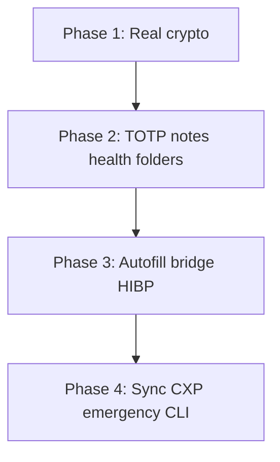

# Feature Research Report — my-enkript

> For **current** app behavior and user-facing functionality, see [FEATURES.md](./FEATURES.md). This report reflects May 2026 market research and an earlier product baseline; some gaps listed below have since been addressed in code.

**Date:** May 17, 2026  
**Scope:** Internet research on password-manager and local-vault trends (2025–2026), mapped to the current my-enkript codebase and a prioritized feature roadmap.

---

## 1. Executive summary

- **my-enkript** is a mobile-first Expo/React Native vault with solid UX foundations (PIN unlock, password CRUD, generator, import/export, passkey bridge scaffolding) but **security and platform integration are not yet production-grade** — vault data uses a base64 stub envelope (`vaultstub:v1`), not real AEAD.
- **2026 user expectations** for password managers center on passkeys, native OS autofill, built-in TOTP, security health monitoring, and zero-knowledge encryption — not just password storage.
- **Highest-impact work (P0):** replace stub crypto with Argon2id + XChaCha20-Poly1305 (or equivalent), and wire native iOS/Android credential providers via the existing autofill hooks.
- **Quick wins (P1):** TOTP per login, secure notes and payment cards, local vault health dashboard, and folders/tags beyond the fixed category enum.
- **Differentiator path:** finish the browser bridge + relay for desktop fill and passkey signing, then add passkey portability (Credential Exchange Protocol on iOS) where platforms allow.
- **Defer for now:** enterprise SSO/SCIM, team RBAC, and AI-agent secret routing — out of scope for a personal/local-first mobile vault unless the product pivots to B2B.

---

## 2. App baseline (May 2026)

### 2.1 Product positioning

| Attribute | Current state |
|-----------|---------------|
| **Platform** | iOS & Android via Expo ~54 / React Native 0.81 |
| **Storage** | Local vault in `expo-secure-store`; no cloud sync |
| **Unlock** | PIN (bcrypt hash); biometrics for **reveal** only, not vault unlock |
| **Bundle ID** | `com.maxhuni.eroll.myenkript` (`app.json`) |
| **Companion** | Chrome MV3 extension + Node WebSocket relay (scaffold) |

### 2.2 Implemented features

#### Core vault & session

| Feature | Location |
|---------|----------|
| PIN setup wizard (length picker, confirm) | `app/lock.tsx` |
| Unlock, auto-lock (30s–never), 5 failed attempts RAM wipe | `stores/vault-lock-store.ts`, `components/vault/session-bootstrap.tsx` |
| Vault persist shape (passwords, passkeys, paired devices) | `lib/types.ts` → `VaultPersistShape` |
| Repository read/write | `lib/vault-repository.ts` |
| PIN session (bcrypt) | `lib/pin-session.ts` |
| Stub envelope encrypt/decrypt | `lib/crypto.ts` (`vaultstub:v1`) |

#### Passwords tab

- List with search and category grouping (`social`, `work`, `finance`, `shopping`, `other`)
- Add / edit / detail / delete; long-press actions
- Reveal with optional biometrics; copy with 30s clipboard clear
- Domain favicons; strength meter on forms
- Inline password generator on new/edit screens — `app/(tabs)/passwords/`

#### Generator tab

- Standalone generator: length slider, charset toggles, entropy meter — `app/(tabs)/generator.tsx`

#### Passkeys tab

- List passkeys synced from browser bridge; swipe to delete
- No in-app passkey creation — `app/(tabs)/passkeys.tsx`
- P-256 create/sign — `lib/passkey-service.ts`, `components/vault/bridge-wire-sync.tsx`

#### Settings

| Screen | Path |
|--------|------|
| Appearance (light/dark/system) | `app/(tabs)/settings/appearance.tsx` |
| Security (biometrics, lock timeout, change PIN, lock now) | `app/(tabs)/settings/security.tsx` |
| Autofill (OS settings shortcuts + guide) | `app/(tabs)/settings/autofill.tsx` |
| Import / export CSV (1Password, Bitwarden detect) | `app/(tabs)/settings/import-export.tsx` |
| Browser bridge (QR pair, revoke devices) | `app/(tabs)/settings/browser-bridge.tsx` |

#### Bridge & extension (partial)

- WebSocket relay fans messages by `sessionId` — `relay/server.mjs`
- Bridge protocol: credentials query, fill approve/deny, passkey create/get, pairing — `lib/bridge-protocol.ts`
- Chrome extension “Vault Bridge” v0.1 — `browser-extension/` (assist button, WebAuthn logging)
- Relay URL from `app.json` `extra.vaultRelayWsUrl` — `lib/constants.ts`

#### Autofill (guidance only)

- OS settings deep links + post-unlock onboarding — `lib/autofill-settings.ts`, `components/vault/autofill-unlock-prompt.tsx`
- **Native credential provider not wired** — `lib/autofill-registry.ts` is a no-op placeholder
- Expo manifest plugin — `plugins/with-autofill-manifest.js`

#### Quality & tooling

- Jest + Testing Library across `**/__tests__/**`
- Storybook (dev only) — `.rnstorybook/`, `app/storybook.tsx`
- EAS build config — `eas.json`

### 2.3 Known gaps (from code)

1. **No real encryption at rest** — `lib/crypto.ts` base64-wraps JSON; anyone with device access and the stub format can decode.
2. **Autofill is instructional only** — users must manually copy/paste or use the browser bridge; no iOS Password AutoFill / Android Autofill Service integration.
3. **Item model is passwords-only** — `PasswordEntry` in `lib/types.ts`; no TOTP, cards, or secure notes types.
4. **Bridge/extension are scaffolding** — production relay URL is a placeholder; extension intercepts WebAuthn for logging, not full fill flows.
5. **No security monitoring** — no weak/reused password audit or breach checks.
6. **No sync or backup** — single-device vault; export CSV is the only portability path.

---

## 3. Market trends (2025–2026)

Research synthesized from public password-manager roadmaps, security comparisons, and local-vault products.

### 3.1 Passkeys are baseline, portability matters

- Consumer passkey adoption is mainstream; managers are expected to **create, store, and sync** passkeys across devices.
- **iOS 26+ Credential Exchange Protocol (CXP)** enables encrypted passkey transfer between apps — a 2026 differentiator for apps with a passkeys tab (like my-enkript).
- Cross-platform passkey sync (extension + mobile + desktop) is table stakes for serious products.

**Sources:** [Password managers 2026 — DecodeIT](https://decodeit.app/en/security/guides/password-managers-2026)

### 3.2 Zero-knowledge and strong KDFs

- Industry standard: **client-side AEAD** (AES-256-GCM or XChaCha20-Poly1305) with keys derived via **Argon2id** or scrypt from the master secret/PIN.
- Open-source or independently audited crypto (Bitwarden, Proton Pass) is a trust signal; proprietary apps rely on audits (1Password).
- NIST-aligned guidance pushes **15+ character** generated passwords; short passwords are trivially cracked with modern GPU/AI-assisted attacks.

**Sources:** [ChromeThemer security comparison 2026](https://www.chromethemer.com/password-manager-security-features-comparison/), [How to choose a password manager 2026](https://www.sentrly.com/buyer-guides/how-to-choose-a-password-manager.html)

### 3.3 Autofill depth beyond username/password

Leading products (e.g. Proton Pass 2025–2026) invest in:

- Credit card autofill
- HTTP Basic Auth dialogs
- Auto-type / iframe autofill for complex layouts (banking, nested iframes)
- Configurable URL matching (exact site vs registrable domain)
- Browser extension **biometric unlock** (fingerprint/face instead of master password each session)
- Extension **offline mode** when relay/sync is unavailable

**Source:** [Proton Pass spring/summer 2026 roadmap](https://proton.me/blog/pass-roadmap-spring-summer-2026)

### 3.4 Security monitoring (“Pass Monitor” pattern)

- In-extension and in-app dashboards for **weak**, **reused**, and **old** passwords.
- **Have I Been Pwned (HIBP)** k-anonymity API for breach checks without sending full passwords.
- Configurable **clipboard clear** intervals (my-enkript already clears after 30s — align with user preference in settings).

### 3.5 Developer and power-user workflows

- **SSH key storage** with an OS SSH agent (Proton Pass 2026).
- **CLI + scoped personal access tokens** for scripts and automation.
- These require desktop targets and mature crypto — later phase for my-enkript.

### 3.6 Local-first vault patterns

Products like Passave, Krypt, PanicVault, and local-vault OSS emphasize:

- Encrypt locally before any optional cloud sync
- Biometric unlock for vault (not only for individual field reveal)
- Built-in **TOTP authenticator**
- **Secure notes** and **encrypted file** attachments
- Optional **decoy vault** / duress PIN for plausible deniability
- Offline-first: all features work without network

**Sources:** [Passave](https://passave.org/), [Krypt](https://thekryptvault.com/), [PanicVault](https://www.panicvault.org/), [local-vault (GitHub)](https://github.com/mylofi/local-vault)

---

## 4. Recommended features (prioritized for my-enkript)

Each item includes user value, architectural fit, effort estimate, and dependencies.

### P0 — Blockers for trust and core PM expectations

#### 4.1 Real vault encryption (replace `vaultstub:v1`)

| | |
|---|---|
| **User value** | Data at rest is protected if the device is compromised or backups are extracted. |
| **Fit** | Drop-in replacement in `lib/crypto.ts`; `vault-repository.ts` already centralizes read/write. Use `@noble/ciphers` / `@noble/hashes` (already in `package.json`) or `expo-crypto` where appropriate. |
| **Effort** | **L** — migration path for existing installs, versioned envelope (`vault:v2:`), tests in `lib/__tests__/crypto.test.ts`. |
| **Dependencies** | Argon2id (or scrypt) key derivation from PIN; random salt per vault; AEAD nonce handling. |
| **Design** | `PIN → KDF → vaultKey`; encrypt `VaultPersistShape` JSON as single blob or per-field for passkeys. |

#### 4.2 Native credential provider (iOS + Android)

| | |
|---|---|
| **User value** | System-wide autofill in Safari, Chrome, and apps — the #1 reason people install a password manager. |
| **Fit** | Wire `lib/autofill-registry.ts`; extend `plugins/with-autofill-manifest.js`; map `PasswordEntry` + future item types to platform credential APIs. |
| **Effort** | **L** — requires native modules or Expo config plugins; Apple AutoFill entitlement; Android AutofillService. |
| **Dependencies** | Real encryption (P0.1); stable item schema. |
| **Note** | Settings autofill screen (`app/(tabs)/settings/autofill.tsx`) already guides users — keep as onboarding after implementation. |

---

### P1 — High value, fits local-first mobile vault

#### 4.3 TOTP authenticator per login

| | |
|---|---|
| **User value** | Replace separate authenticator apps; one unlock for passwords + 2FA codes. |
| **Fit** | Extend `lib/types.ts` with `totpSecret` on `PasswordEntry` or new `TotpEntry`; reuse reveal/copy/biometric patterns. |
| **Effort** | **M** — `otpauth://` import, 30s code display, optional QR scan (`expo-camera`). |
| **Dependencies** | None beyond current vault. |

#### 4.4 Secure notes and payment cards

| | |
|---|---|
| **User value** | Store Wi‑Fi passwords, recovery codes, licenses, and card numbers securely. |
| **Fit** | New discriminated union in `VaultPersistShape`; new tabs or filtered lists under Passwords. |
| **Effort** | **M** — UI forms, import/export CSV columns, bridge protocol extensions for card fill. |
| **Dependencies** | Real encryption recommended before storing PAN-like data. |

#### 4.5 Vault health dashboard

| | |
|---|---|
| **User value** | Actionable list of weak, reused, and old passwords without leaving the app. |
| **Fit** | Local analysis using existing `lib/password-entropy.ts` and password list in `stores/vault-store.ts`. |
| **Effort** | **S–M** — new settings sub-screen or Security section widget. |
| **Dependencies** | None (fully offline). |

#### 4.6 Folders and tags (beyond fixed categories)

| | |
|---|---|
| **User value** | Organize by project, client, or year; categories alone are too coarse. |
| **Fit** | Add `folderId` / `tags: string[]` to entries; Proton notes folders require crypto model changes — plan schema early. |
| **Effort** | **M** — list UI filters, migration for existing entries defaulting to `other`. |
| **Dependencies** | None. |

---

### P2 — Platform integration and competitive parity

#### 4.7 Have I Been Pwned (breach check)

| | |
|---|---|
| **User value** | Alert when emails/passwords appear in known breaches. |
| **Fit** | Optional network call from settings or health dashboard; k-anonymity range API only. |
| **Effort** | **S** — no full password leaves device. |
| **Dependencies** | User consent + privacy policy disclosure. |
| **API** | [HIBP Pwned Passwords](https://haveibeenpwned.com/API/v3#PwnedPasswords) |

#### 4.8 Complete browser bridge

| | |
|---|---|
| **User value** | Fill and passkey sign-in on desktop Chrome/Firefox without manual copy. |
| **Fit** | Harden `browser-extension/`, `relay/server.mjs`, `lib/bridge-protocol.ts`; deploy production `vaultRelayWsUrl`; end-to-end pairing tests. |
| **Effort** | **L** — iframe URL matching, fill approve UX, extension biometric unlock, offline cache. |
| **Dependencies** | Real encryption; stable credential query API. |

#### 4.9 Passkey portability (CXP / export)

| | |
|---|---|
| **User value** | Move passkeys between devices and apps without re-registering on every site. |
| **Fit** | Extends `PasskeyEntry` and passkeys tab; platform-specific APIs on iOS 26+. |
| **Effort** | **L** — platform-gated. |
| **Dependencies** | Mature passkey storage in vault. |

#### 4.10 Emergency access / trusted contact

| | |
|---|---|
| **User value** | Account recovery if PIN is forgotten, without vendor access to plaintext. |
| **Fit** | Encrypted vault key shard or time-delayed share to contact’s public key. |
| **Effort** | **L** — crypto protocol design + UX. |
| **Dependencies** | Real encryption (P0.1). |

---

### P3 — Advanced / differentiation (later)

| Feature | User value | Effort | Notes |
|---------|------------|--------|-------|
| **Encrypted backup / sync** (iCloud, Drive, self-hosted) | Multi-device vault | L | Ciphertext-only on wire; conflict resolution |
| **SSH key storage + agent** | Dev workflows on desktop | L | Needs desktop companion app |
| **Decoy vault / duress PIN** | Plausible deniability | M | Second PIN opens empty or decoy dataset |
| **CLI + scoped tokens** | Automation, CI secrets | L | After crypto + optional sync |
| **Biometric vault unlock** | Faster unlock than PIN | M | Extend `hooks/useVaultAuth.ts`; threat model vs PIN-only |
| **Watch / widget quick TOTP** | Glanceable codes | M | Expo widgets |

---

## 5. Phased roadmap

### Phase 1 — Foundation (trust)

1. Implement Argon2id + XChaCha20-Poly1305 (or AES-256-GCM) in `lib/crypto.ts` with versioned migration from `vaultstub:v1`.
2. Add crypto unit tests and a one-time migration on unlock.
3. Document threat model in code comments (what PIN protects, what biometrics protect).
4. Security review: no secrets in logs, SecureStore keys, memory zeroing on lock.

### Phase 2 — Core vault (retention)

1. TOTP fields and code display UI.
2. Secure notes + payment card item types in `lib/types.ts` and CRUD screens.
3. Vault health dashboard (weak / reused / stale).
4. Folders or tags; update import/export for new types.

### Phase 3 — Platform integration (growth)

1. Native iOS Password AutoFill + Android Autofill Service via `lib/autofill-registry.ts`.
2. Production relay deployment; harden browser extension fill and passkey flows.
3. HIBP breach check (opt-in).
4. Optional: biometric vault unlock setting in Security screen.

### Phase 4 — Advanced (differentiation)

1. Encrypted backup/sync provider.
2. Passkey CXP portability where supported.
3. Emergency access.
4. Desktop SSH agent or CLI (if product expands beyond mobile).

---

## 6. Competitive snapshot

| Capability | Bitwarden | 1Password | Proton Pass | iOS/macOS Keychain | **my-enkript (today)** |
|------------|-----------|-----------|-------------|--------------------|-------------------------|
| Open / auditable crypto | Yes (OSS) | Audited closed | OSS | OS-integrated | Stub only |
| Mobile app | Yes | Yes | Yes | Yes | Yes (Expo) |
| Browser extension | Yes | Yes | Yes | Safari only | Scaffold |
| Native autofill | Yes | Yes | Yes | Yes | Guide only |
| TOTP built-in | Yes | Yes | Yes | Limited | No |
| Passkeys | Yes | Yes | Yes | Yes | Bridge only |
| Breach monitoring | Yes | Yes | Yes | iCloud Keychain | No |
| Local-only / no account | Self-host option | No | Optional | Yes | **Yes (strength)** |
| Custom bridge / relay | N/A | N/A | N/A | N/A | **Unique path** |

**Positioning opportunity:** A privacy-focused, **local-first mobile vault** with optional **self-hosted relay** for desktop fill — no vendor cloud, no subscription — if P0 crypto and autofill are delivered.

---

## 7. Out of scope (for now)

| Area | Why defer |
|------|-----------|
| Enterprise SSO / SCIM | Requires identity provider integrations and admin console |
| Team vaults / RBAC | Different product; needs org billing and policy engine |
| AI agent secret routing / PATs | Niche; needs CLI and stable API surface |
| Hardware security key (FIDO2) as vault unlock | Complex; passkeys cover most WebAuthn use cases |
| Built-in VPN / email alias | Proton ecosystem features; scope creep |

Revisit if my-enkript pivots to teams or developer-first positioning.

---

## 8. References

### Password manager market & security

- [Best Password Managers 2026 — DecodeIT](https://decodeit.app/en/security/guides/password-managers-2026)
- [How to Choose a Password Manager: 2026 Buyer's Guide — Sentrly](https://www.sentrly.com/buyer-guides/how-to-choose-a-password-manager.html)
- [Password Manager Security Features Comparison (2026) — ChromeThemer](https://www.chromethemer.com/password-manager-security-features-comparison/)
- [Enterprise Password Managers 2026 — ITECS](https://itecsonline.com/post/best-enterprise-password-managers-2026-1password-vs-dashlane-vs-keeper-vs-bitwarden)

### Product roadmaps & features

- [Proton Pass spring and summer 2026 roadmap](https://proton.me/blog/pass-roadmap-spring-summer-2026)
- [Proton Pass CLI](https://proton.me/blog/proton-pass-cli)

### Local-first / vault products

- [Passave](https://passave.org/)
- [Krypt — Zero-Knowledge Password Manager](https://thekryptvault.com/)
- [PanicVault](https://www.panicvault.org/)
- [local-vault (GitHub)](https://github.com/mylofi/local-vault)

### Breach checking

- [Have I Been Pwned API v3](https://haveibeenpwned.com/API/v3)

### my-enkript codebase (internal)

- `lib/crypto.ts` — encryption stub
- `lib/types.ts` — data model
- `lib/autofill-registry.ts` — autofill placeholder
- `lib/bridge-protocol.ts` — browser bridge messages
- `app/(tabs)/` — main user-facing features

---

*This report is intended for product planning. Implementation order should follow P0 → P1 → P2 unless a specific release goal dictates otherwise (e.g. shipping bridge demo before HIBP).*
